# Tarea: Balanceador de carga con Apache
## IWEB - ASIR 2
### Carla González Da Costa
### 12/11/2026

### Introducción:
En esta práctica nos hemos propuesto montar una infraestructura web profesional y robusta, como si fuera un entornos real para que las páginas no se caigan y aguanten muchas visitas. Para conseguirlo, en lugar de meterlo todo en un único servidor, hemos dividido el trabajo en cuatro máquinas virtuales independientes que se comunican entre sí en una red privada.

La infraestructura se divide en tres niveles:

**1. El Balanceador de Carga:** Es la puerta de entrada de todo el sistema. Recibe las peticiones de los usuarios desde fuera y las va repartiendo por igual entre los servidores web.

**2. Dos servidores web:** Son las dos máquinas que tienen instalada la pila LAMP (Linux, Apache, MySQL, PHP) y se encargan de procesar las páginas web y atender lo que pide el balanceador.

**3. Base de Datos (Back-End):** Una máquina única dedicada en exclusiva a albergar el servidor MySQL para guardar toda la información de forma centralizada y segura.

Para crear todo esto, voy ha automatizar la instalación mediante scripts en Bash. 

### 1. Arquitectura y despliegue de la insfraestructura.

Para levantar todo este entorno sin tener que instalar los sistemas operativos uno por uno a mano, he utilizado el mecanismo de Vagrant. Mediante un único archivo de configuración (Vagrantfile), despliego simultáneamente las cuatro máquinas virtuales con Ubuntu Server 22.04 LTS y las conecto a través de una red privada interna con IPs estáticas

| Máquina Virtual | Arquitectura | IP
| --- | --- | --- |
| balanceador | Proxy | 192.168.56.10 |
| frontal1 | servidor web 1 (Pila LAMP) | 192.168.56.11 |
| frontal2 | servidor web 2 (Pila LAMP) | 192.168.56.12 |
| back-mysql | servidor de base de datos MySQL | 192.168.56.13 |

### 2. Crear carpeta y levantar VMs

Voy a crear una carpeta llamada practica_balanceador, dentro de mi carpeta principal ASIR_2/WEB
Entro en el cmd desde ese directorio y creo el vagrantfile `vagrant init`

### 3. Editar el vagrantfile e iniciar las VMs.

Abro el vagrantfile VSCode `code ./Vagrantfile` y edito el archivo para que me crea las 4 VMs junto a sus IPs , red y puertos correspondiente. 
Ahora hago `vagrant up` para iniciar todas las VMs. 

**INCIDENCIA:**

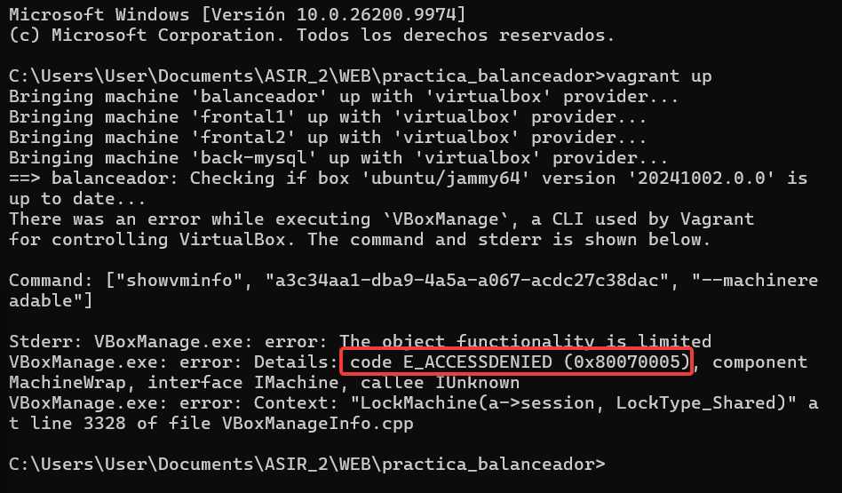

Al intentar ejecutar la práctica apareció un error en VirtualBox que impedía a Vagrant acceder correctamente a las máquinas virtuales. Tras revisar el problema e investigar información adicional, ya que esta situación no se explicaba en los apuntes, comprobé que estaba relacionado con la información almacenada en la carpeta .vagrant, que había quedado desactualizada al mover la práctica de ubicación. Eliminé dicha carpeta para que Vagrant generara una nueva configuración y pude continuar con el despliegue.

**INCIDENCIA:**
Ahora me aparece un nuevo error con la vm frontal1 debido a que durante el despliegue aparece un error de tiempo de espera agotado al intentar conectarme por SSH a la máquina frontal1. Aunque la máquina virtual arranca correctamente en VirtualBox, Vagrant no consigue establecer la conexión dentro del tiempo previsto, por lo que el proceso se detiene y tengo que revisar el estado de la máquina y la configuración de red para continuar con el despliegue.

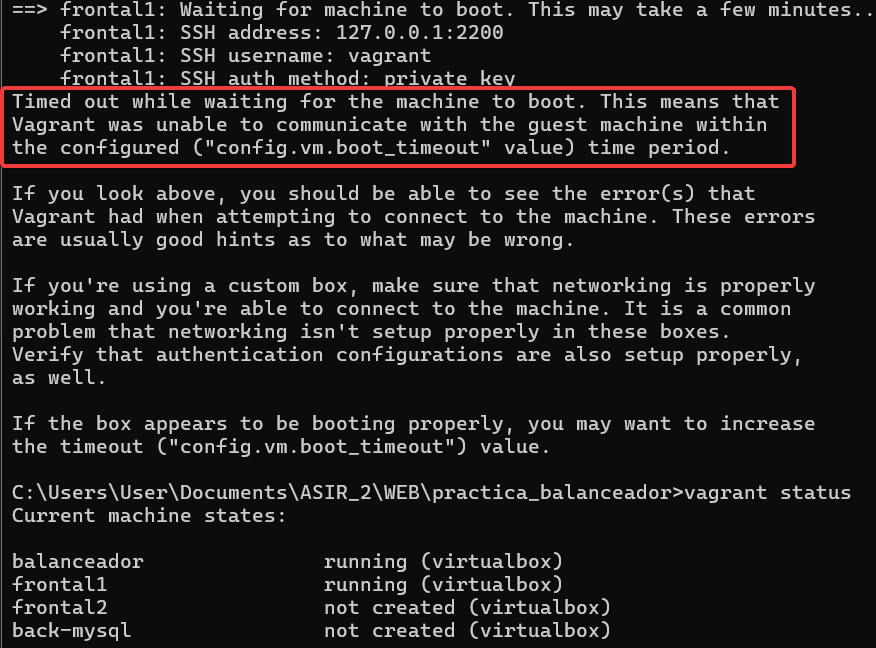

Para solucionar el problema, primero accedo a la máquina virtual desde VirtualBox y compruebo que el sistema operativo ha terminado de arrancar correctamente, ya que aparece la pantalla de inicio de sesión de Ubuntu. A continuación inicio sesión con el usuario vagrant y verifico que el servicio SSH está funcionando mediante el comando `sudo systemctl status ssh`
Al comprobar que el servicio se encuentra activo, vuelvo al host y reinicio la máquina gestionada por Vagrant con `vagrant reload frontal1`
Se ha podido establecer correctamente la conexion por ssh y se ha terminado la configuración de la vm frontal1. 

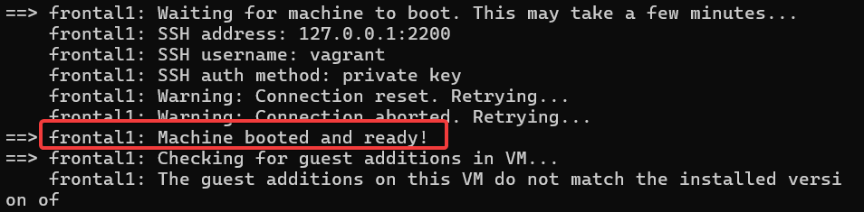


Continuo con el inicio del resto de VMs: frontal2 y back-mysql. Para ello ejecuto: `vagrant up frontal2` y `vagrant up back-mysql`

Al iniciar frontal2 `vagrant up frontal2` me ha salido el mismo error de conexión ssh. Por ello, inicié sesión directamnete desde la consola con el usuario vagrant y verifico que el servicio shh está activo.

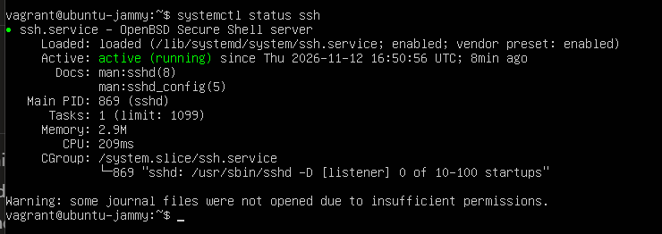

Tras estas comprobaciones, confirmo que no existe un fallo real de funcionamiento, sino que el primer arranque de la máquina virtual requiere más tiempo del esperado y da la impresión de haberse quedado bloqueado cuando en realidad termina iniciándose correctamente. 

Ahora paso al inicio de la última vm back-mysql. 
Con esta vm, me pasa lo mismo, Vagrant no consigue conectarse inmediatamente por SSH porque Ubuntu tarda más de lo esperado en completar la inicialización del sistema. Aunque Vagrant muestra errores o avisos relacionados con la conexión, al comprobar el estado de las máquinas desde VirtualBox se verifica que terminan arrancando correctamente y que el servicio SSH está activo. 

Verifico que las cuatro máquinas virtuales están listas:

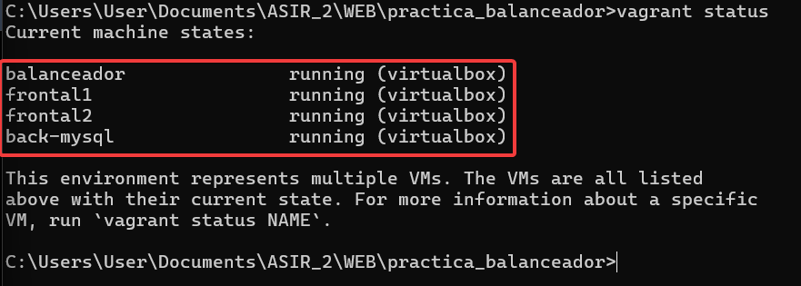


### 4. Comprobar las IPs y conectividad entre las capas. 

Entro por ssh en todas las VMs y con `ip a` compruebo sus IPs estáticas.

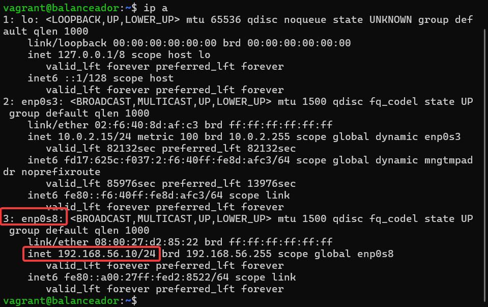

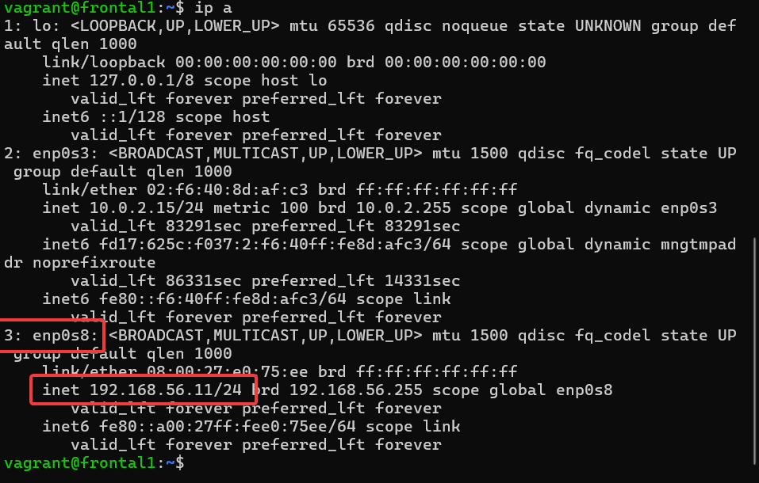

**INCIDENCIA:**

Tanto en la conexión de ssh de frontal2 y back-mysql como nombre de host me aparece ubuntu-jammy y no aparece la IP estática.

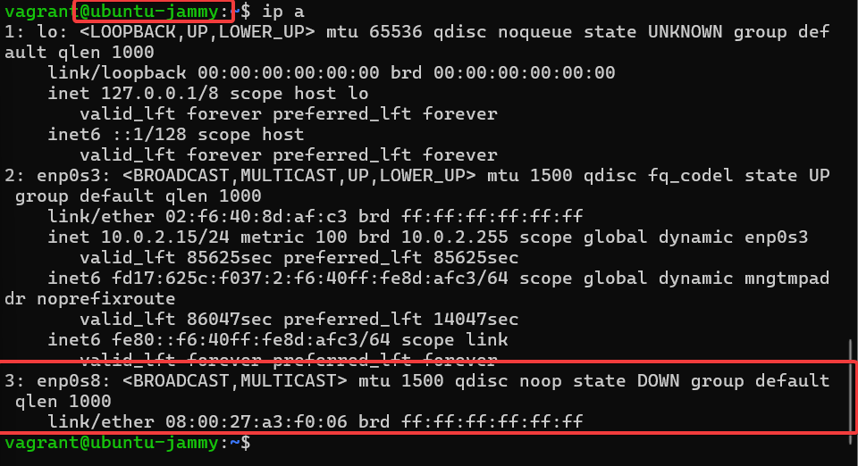

He verificado el vagrantfile y está correcto. 

Lo que he hecho con frontal2 y back-mysql es elimianrlas `vagrant destroy frontal2/back-mysql-f` y luego hacer un `vagrant up` y una vez terminado me he conectado por ssh a la vm `vagrant ssh frontal2/back-mysql` y ha funcionado correctamente.

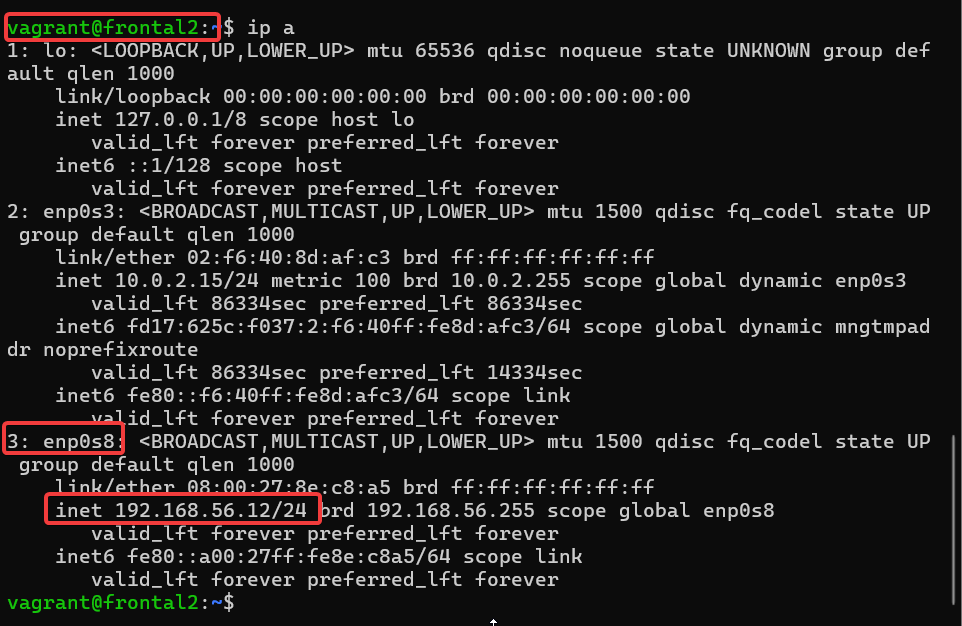

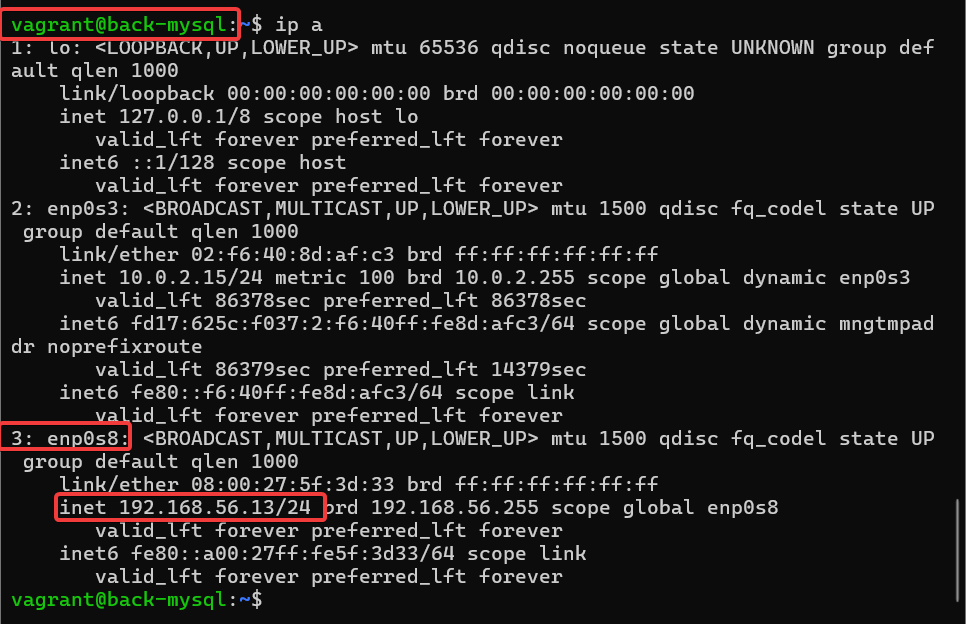


Ahora paso a comprobar la conectividad entre los diferentes niveles:
1. Pruebo la conectividad desde el balanceador a los frontales.
   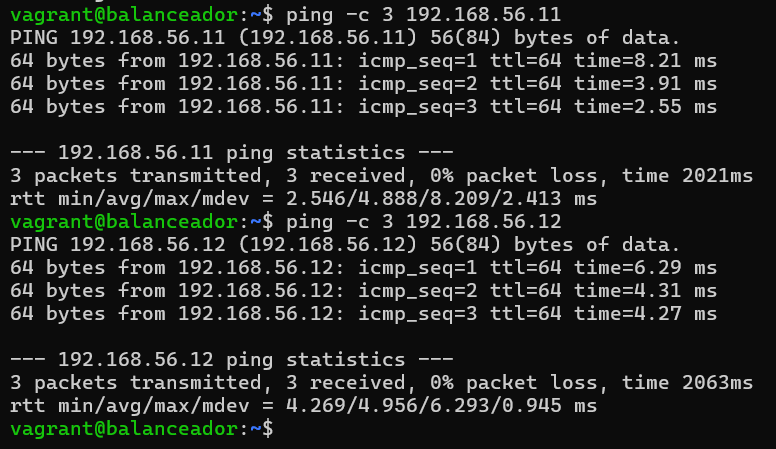

2. Hago ping desde los frontales a la vm de la base de datos.
   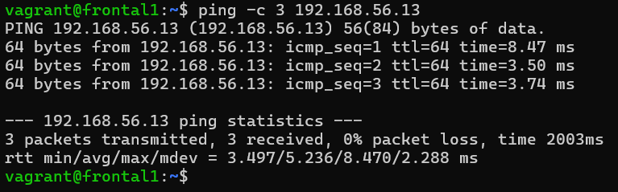
   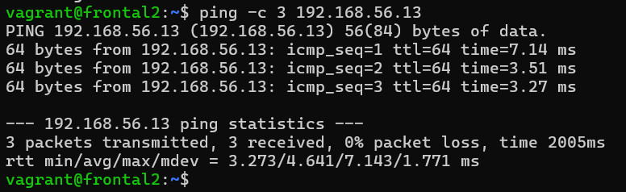


### 5. Instalar servidor web (Apache) en frontales.
Me conecto por ssh al frontal1 y ejecuto estos comandos:
```bash
sudo apt update
sudo apt install -y apache2
sudo systemctl status apache2
```
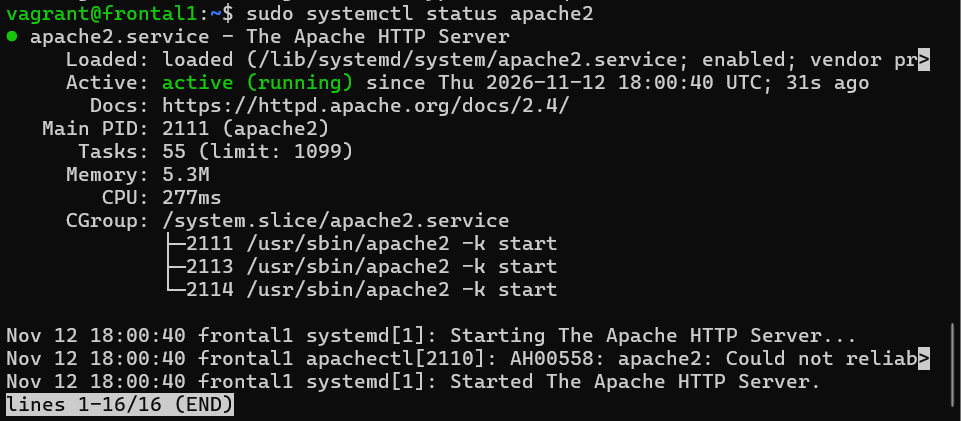
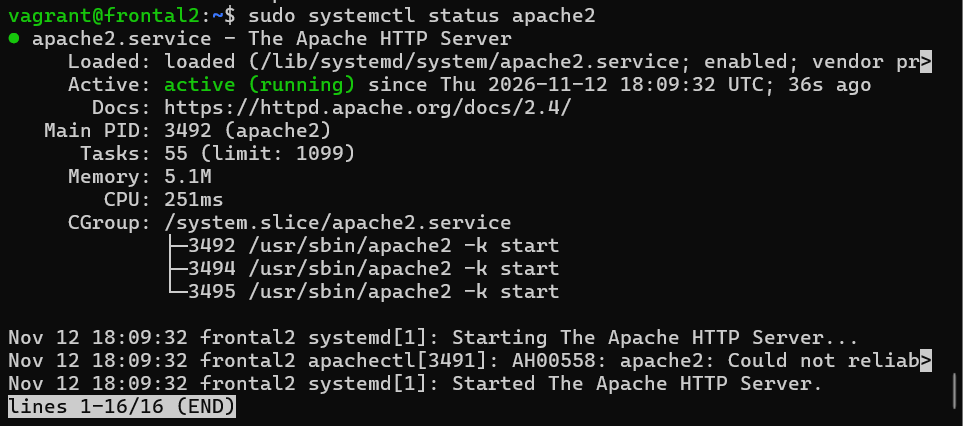


### 6. Instalar Apache en el balanceador 

El objetivo de instalar Apache en el balanceador es que actúe como un proxy inverso. Consiste en actuar como un servidor intermediario que se coloca en la frontera de la red para recibir todas las peticiones que hacen los usuarios desde el exterior y encargarse de distribuirlas hacia los servidores internos reales.

Los comandos a ejecutar son:
```bash
sudo apt update
sudo apt install -y apache2
sudo systemctl status apache2
sudo a2enmod proxy proxy_http proxy_balancer lbmethod_byrequests
```
`sudo a2enmod proxy proxy_http proxy_balancer lbmethod_byrequests` --> consiste en activar los módulos necesarios en Apache para que pueda funcionar como un proxy inverso y repartir el tráfico de manera equilibrada entre los frontales.

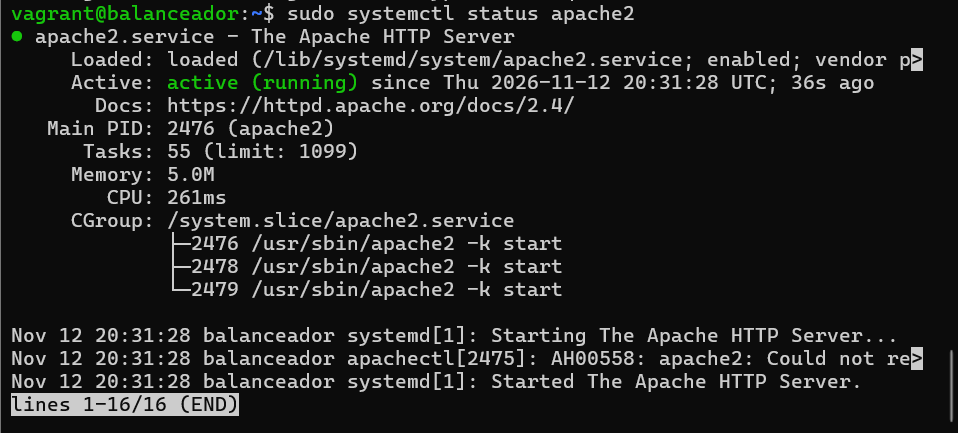

`sudo nano /etc/apache2/sites-available/000-default.conf` 
Hay que editar este fichero porque de forma predeterminada, Apache viene configurado para ser un servidor web simple (muestra una página de bienvenida local). Al editarlo, le decimos que deje de comportarse como una página web normal y corriente, y que se convierta en un proxy inverso (un repartidor de tráfico).

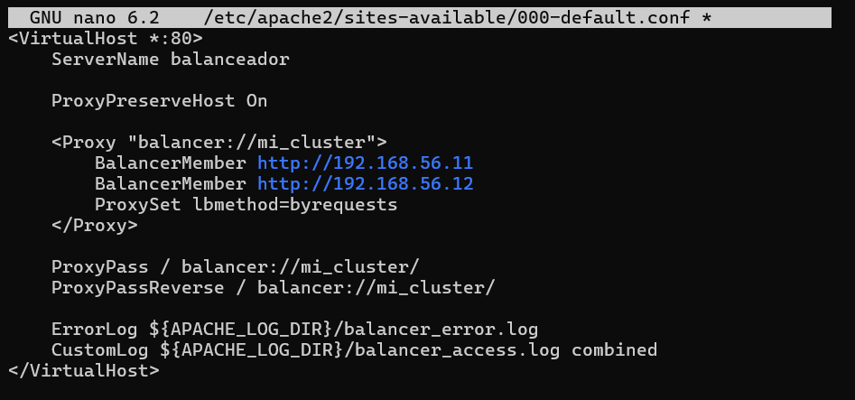

Lo que se dice en el fichero es que Apache tiene que dejar de servir páginas web propias y se convierta en un repartidor de tráfico: intercepta las peticiones que recibe y las distribuye de forma equitativa entre tus dos servidores frontales (192.168.56.11 y 192.168.56.12).

`sudo apache2ctl configtest`--> verifica que no haya errores en el archivo.
`sudo systemctl restart apache2`--> reinicio apache
`exit`--> salir del balanceador

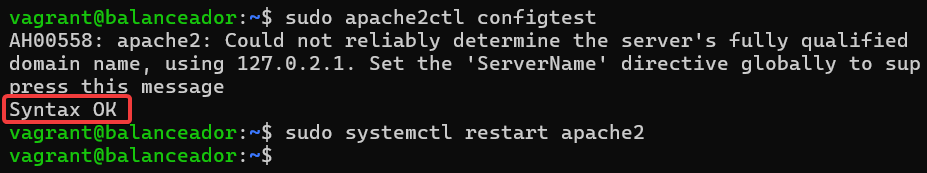


#### Verificar que el balanceador funciona correctamente. 

Para comprobarlo, abro el navegador web y escribo la IP del balanceador: `http://192.168.56.10`

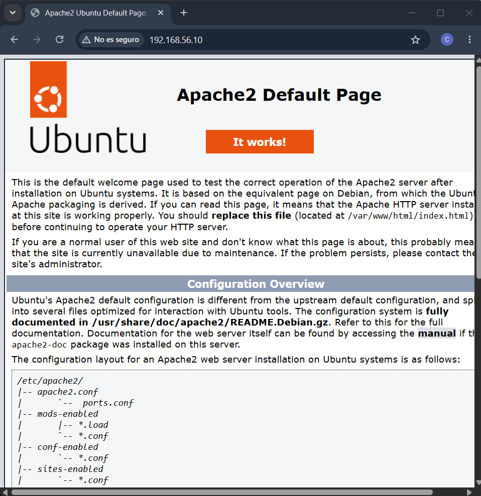

Como no pueod ver si estoy en el frontal1 o frontal2, voy a editar el index.html del cada uno de los frontales para que me indique en cual estoy y así poder identificarlo mejor. 

```bash
vagrant ssh frontal1
echo "<h1>Bienvenido a Frontal 1 (IP: 192.168.56.11)</h1>" | sudo tee /var/www/html/index.html
```
Ahora vuelvo al navegador y pruebo. 

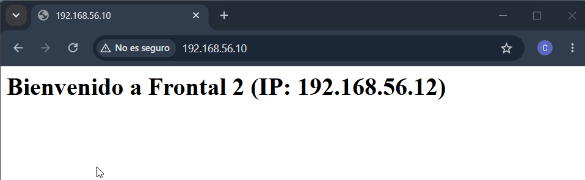
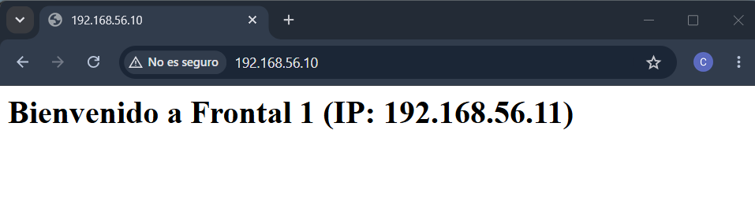

Como vemos en las imágenes adjuntadas funciona correctamente. 


### 7. Configurar el servidor de la base de datos.
 
 1. 
 ```bash
vagrant ssh back-mysql
sudo apt update
sudo apt install -y mysql-server
sudo systemctl mysql-server
```

2. Instalo el servicio de MySQL. 
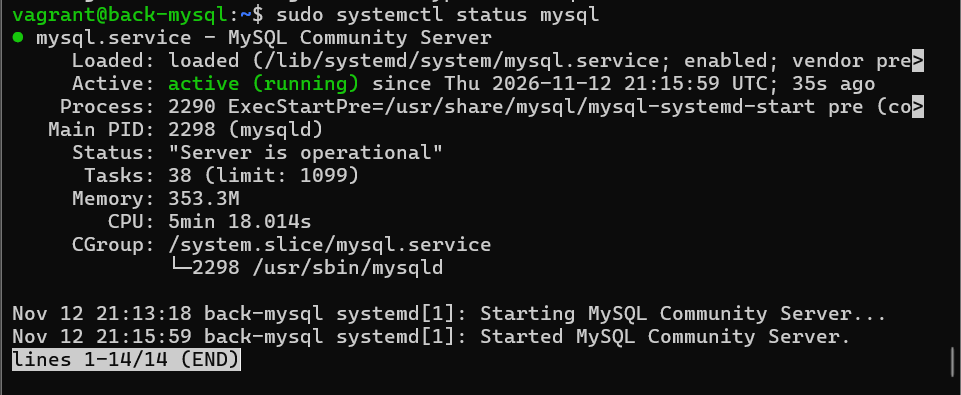

3. Entro en la consola MySQL y creo la base de datos.
   ```bash
   sudo mysql
   CREATE DATABASE iweb_db;
   CREATE USER 'iweb_user'@'%' IDENTIFIED BY 'xxx';
   GRANT ALL PRIVILEGES ON iweb_db.* TO 'iweb_user'@'%';
   FLUSH PRIVILEGES;
   EXIT;
   ```
   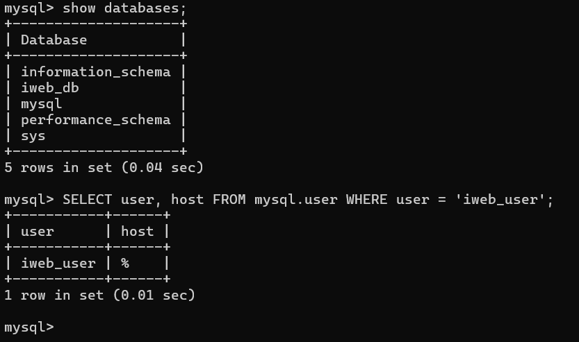
   
4. Permitir conexiones remotas.

- Por defecto, MySQL solo acepta conexiones locales. Para que los servidores frontales puedan conectarse a esta base de datos a través de la red privada hay que editar el fichero `sudo nano /etc/mysql/mysql.conf.d/mysqld.cnf`

- Modifico el comando bin-address por 0.0.0.0

- Reinicio con `sudo systemctl restart mysql` y verifico que está activo `sudo systemctl status mysql`
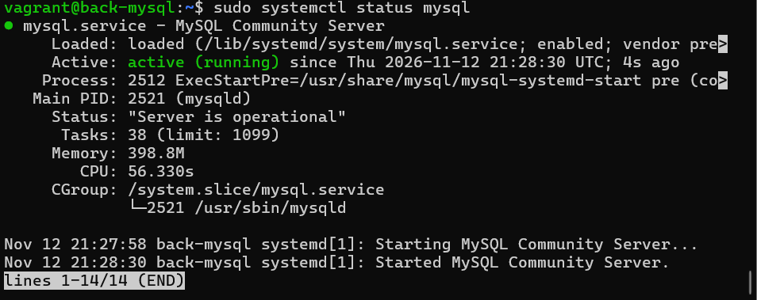

#### Compruebo la base de datos desde el frontal1 y frontal2
`mysql -h 192.168.56.13 -u iweb_user -p`

Me aparece un error indicando que no escuentra el servicio mysql y es debido a qu eno he instalado en los frontales el cliente MySQL, por lo que hago un `sudo apt update` y `sudo apt install -y mysql-client`
Una vez descargado el paquete, pruebo de nuevo la conexión remota. 

La conexión a la base de datos desde frontal1 ha sido un éxito. 
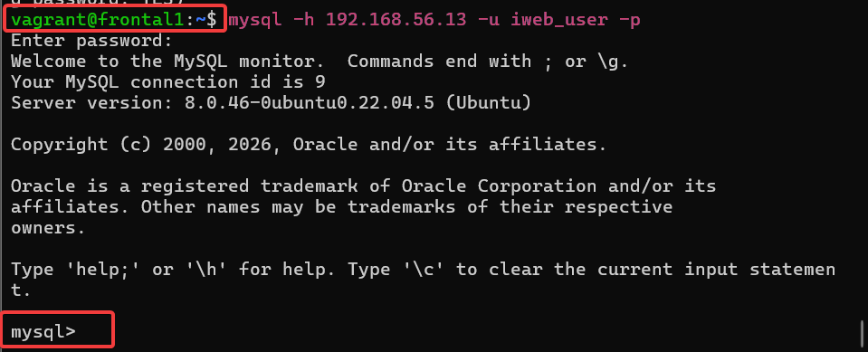

Y desde frontal2, haciendo previamente la instalación de mysql-client.
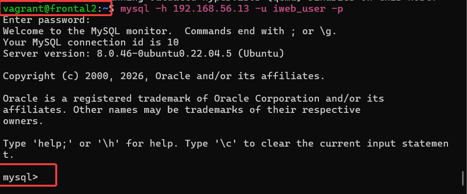


### 8. Comprobar toda la arquitectura de tres niveles. 
El paso final es comprobar toda la arquitectura de esta práctica desde el navegador.
Navegador --> Balanceador --> Servidores Frontales --> Base de Datos MySQL

Antes de todo, para que me aparezca la conexión a una página a la base de datos, voy a crear un fichero `test.php` en los dos servidores frontales. 

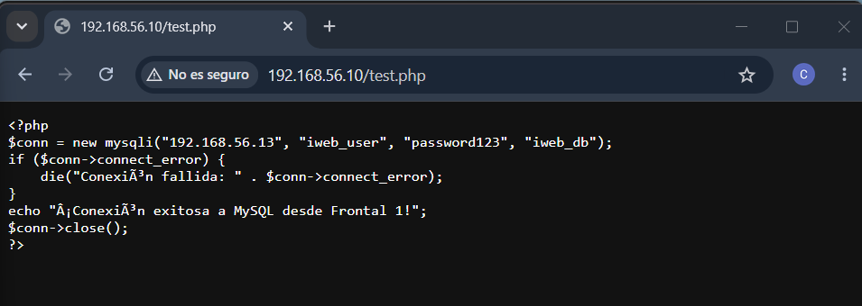
Hay un pequeño error y aparece el código del fichero test.php porque no he instalado el servicio PHP en los frontales, entonces vamos a ello. 

#### Instalar PHP en frontales.
1. 
   ```bash
   vagrant ssh frontal1
   sudo apt update && sudo apt install -y php libapache2-mod-php php-mysql
   sudo a2enmod php*
   sudo systemctl restart apache2
   sudo systemctl status apache2
   ```
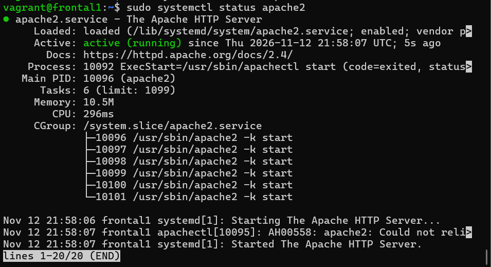
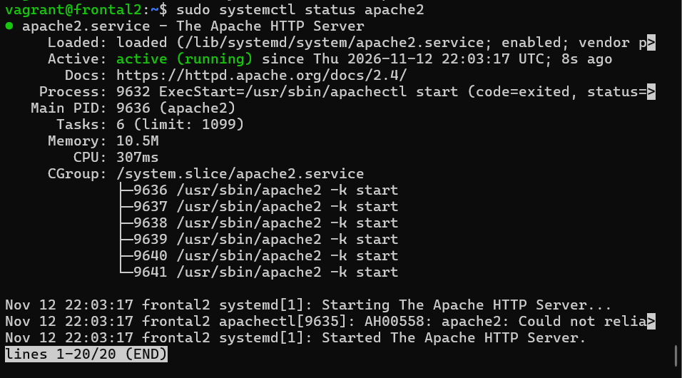

2. Verificar desde el navegador
   Abro el navegador y escribo la direccion hacia la página: `http://192.168.56.10/test.php`

Me sale un error porque no he instalado el paquete php-mysql para que puedan comunicarse ambos servicios en los frontales, asique vamos a ello `sudo apt install -y php-mysql`
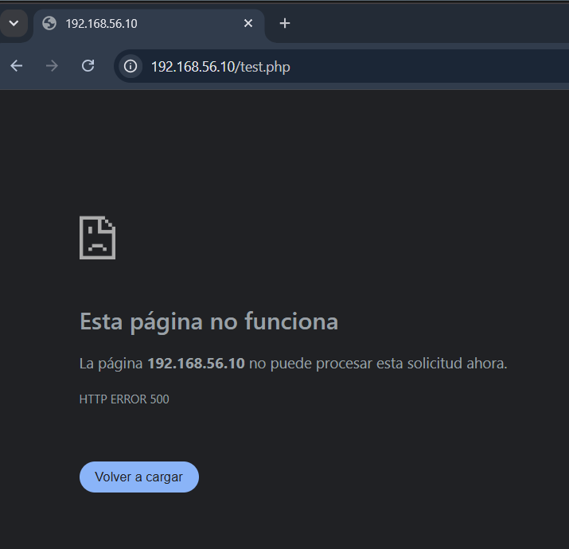

El error sigue, por loq ue después de haber buscado información, voy a habilitar temporalmente la visualización de errores en el archivo de prueba para ver qué está fallando exactamente. Edito el archivo en los frontales:
`sudo nano /var/www/html/test.php`
```bash
ini_set('display_errors', 1);
error_reporting(E_ALL);
```
Sirve para forzar la visualización de los errores directamente en la pantalla de la página web.

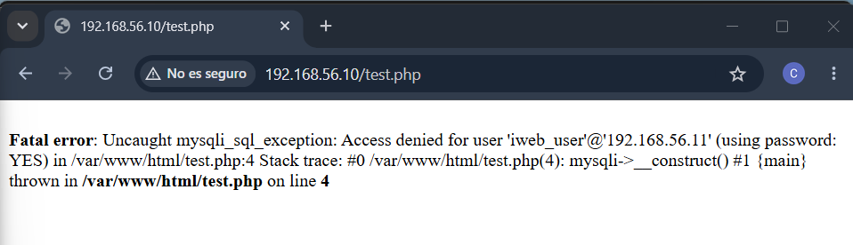

El error Access denied se debía a que el archivo test.php tenía configurada la contraseña antigua del usuario iweb_user. Se actualizó la contraseña en el archivo PHP `(sudo nano /var/www/html/test.php)` para que coincidiera con la almacenada en MySQL, solucionando así el problema de conexión. 
Perfecto, ¡he solucionado el rpoblema!

Ahora cuando escribimo en el navegador la dirección: `http://192.168.56.10/test.php` vemos la página que cree test.php y me indica si estoy en el frontal1 o frontal2. 
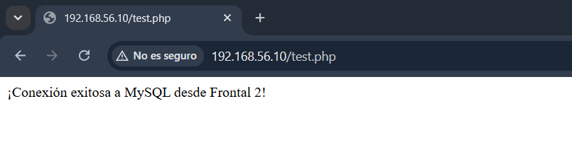


  


